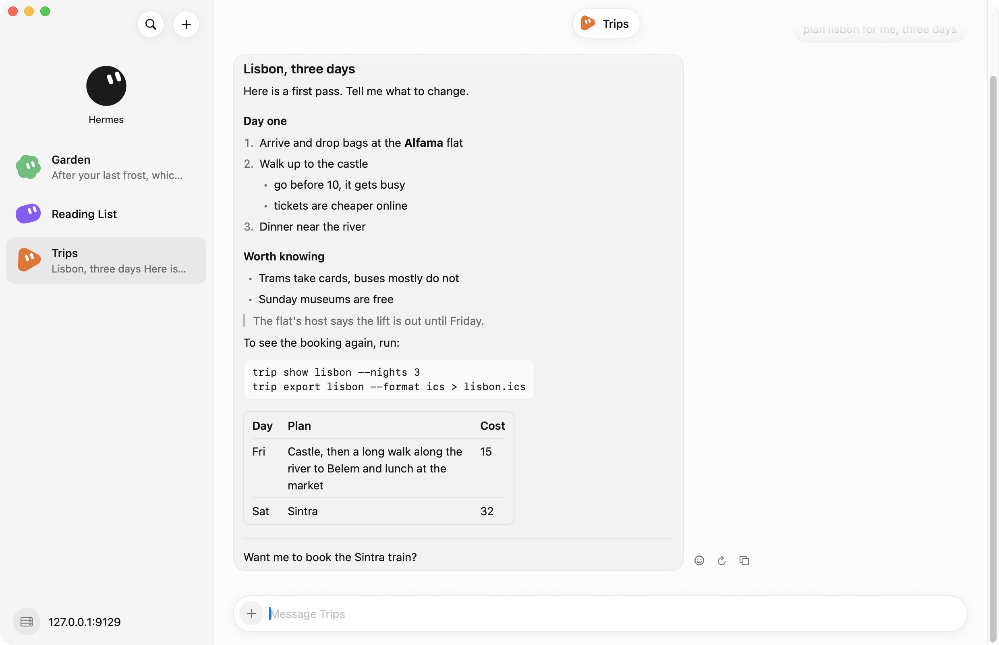
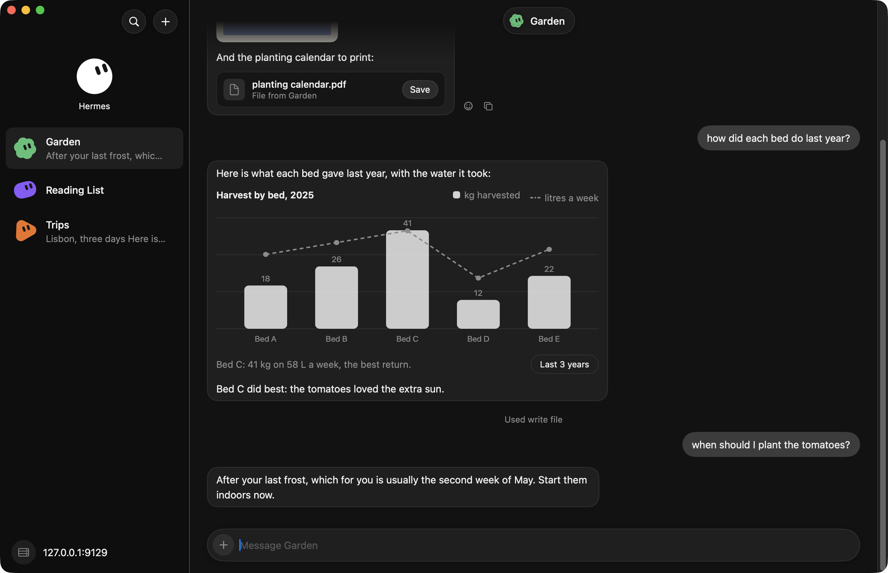
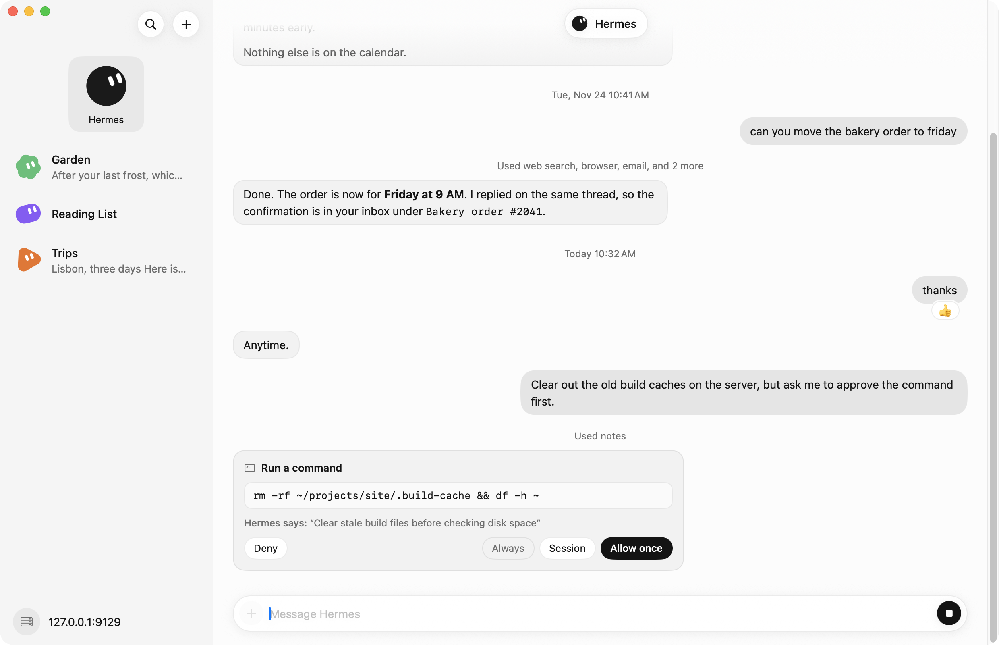
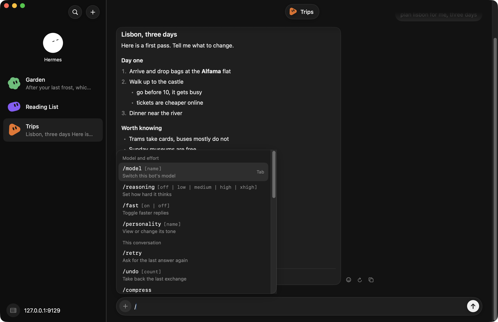

# Hermes Bot

A native Mac app for your [Hermes](https://github.com/NousResearch/hermes-agent) bots.

Not affiliated with Nous Research.

<picture>
  <source media="(prefers-color-scheme: dark)" srcset="docs/screenshots/chat-dark.png">
  
</picture>

## What it does

- Your bots in a sidebar, each with its own face and one permanent chat. A blue dot when one has said something new, even a routine that ran on its own.
- Replies arrive word by word and are laid out properly: lists, tables, code.
- Bots can draw in the chat. A bot writes a small HTML page (a chart, a widget) and it shows inside its reply, in the app's colours, with no network access at all. Click a button in one and the bot can update it.
- Send files and pictures; bots hand files and pictures back.
- When a bot needs you mid-task (may it run a command, a question, a password it needs), it asks in the chat and you answer there. If you're in another chat or the app is in the background, the bot's row says it's waiting and you get a notification. In Settings you choose how often your bots ask before a risky step: every time, only for risky things, or never.
- When a bot wants to connect an app, add an MCP server or install a plugin or skill, a card in the chat shows exactly what will run or be signed in to, and you approve, sign in or skip each one.
- Make, rename and delete bots; pick each one's model and how hard it thinks; edit its personality; see how full its context is.
- Type `/` in the message box for commands: switch model or effort, retry, undo, ask something on the side, and more.
- Search (⌘K), keyboard shortcuts, light and dark.

<p>
  
  
  
</p>

## Get it

Download the latest `Hermes Bot.dmg` from [Releases](../../releases), open it, and drag the app to Applications. It is signed and notarised by Apple. It needs macOS 15 or later and a Hermes gateway you run yourself.

The app updates itself: it checks for a new version once a day (you can turn that off in Settings, or check by hand from the app menu), and every update is signed and checked before it's installed.

## Setting up

The first time it opens it offers Hermes on this Mac, and any servers Hermes's own desktop app already connects to, with nothing to type. Otherwise it asks for your gateway's address, then for whatever that gateway takes: a token (with a command to copy that prints it) or a username and password.

Tokens and sign-ins are kept in your Keychain, nowhere else. The app talks only to your gateway, and once a day to GitHub to see whether a newer version is out.

## Build from source

```sh
(cd Packages/HermesKit && swift test)
(cd Packages/HermesBotUI && swift test)
(cd App && swift test)
cd App && swift run HermesBot
```

The app's tests start `Tools/fake-gateway.py`, a pretend gateway, so they need `python3`. To try the app against it: `python3 Tools/fake-gateway.py 9129` in one terminal, and `HERMES_URL=127.0.0.1:9129 HERMES_TOKEN=demo swift run HermesBot` in `App`.

`Tools/make-app.sh` makes `build/Hermes Bot.app` for Apple silicon and Intel, with updates off. With `SIGN_IDENTITY` set to a Developer ID and `NOTARY_PROFILE` to a stored `notarytool` profile, it also makes a signed, notarised `build/Hermes Bot.dmg`; a copy for other people also needs `BUILD` (higher than the last release's) and `SPARKLE_PUBLIC_ED_KEY` (the public half of the key that signs updates). `Tools/make-appcast.sh` signs a release's update feed, and `Tools/test-release.sh` tries both scripts with a throwaway key.

## Contributing

Issues and pull requests are welcome.

## Support

Hermes Bot is free. If it's useful to you, you can [buy me a coffee](https://ko-fi.com/dantemoony).

## License

MIT. See `LICENSE`.
